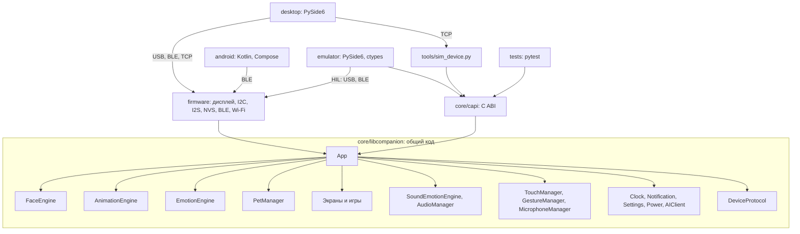
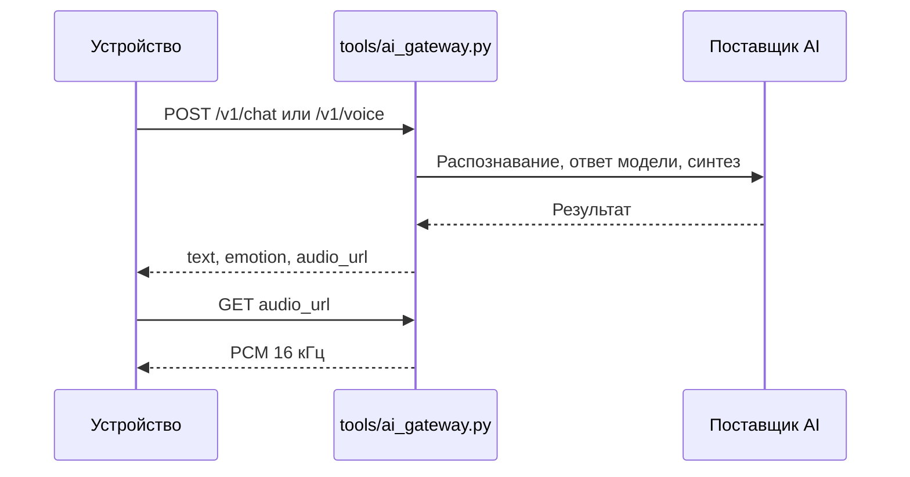

# Архитектура

## Главное решение: одно ядро на все платформы

Вся логика, анимация, отрисовка, экраны, игры, микшер звука и протокол написаны один раз, на C++17, без зависимостей от железа: `core/libcompanion`. Прошивка и эмулятор — тонкие оболочки над ней.

Благодаря этому эмулятор показывает те же пиксели и воспроизводит те же сэмплы, что и устройство. Тесты проверяют код, который реально уходит в прошивку.

LVGL не используется. На главном экране важны плавные формы, которые LVGL не даёт нарисовать дешевле, а меню просты. Свой рендерер занял около 300 строк и работает одинаково на ПК и ESP32.

## Модули

| Модуль из задания | Где |
|---|---|
| FaceEngine, AnimationEngine | `core/libcompanion/src/face.cpp` |
| EmotionEngine | `src/emotion.cpp` |
| PetManager | `src/pet.cpp` |
| SoundEmotionEngine, AudioManager | `src/audio.cpp` |
| TouchManager, GestureManager, MicrophoneManager | `src/input.cpp` |
| ClockManager, NotificationManager, PowerManager, StorageManager, AIClient | `src/services.cpp` |
| SettingsManager | Структура `Settings` в `services.h`, логика в `app.cpp` |
| Экраны | `src/ui.cpp` |
| GameManager | Логика `src/games.cpp`, экраны игр `src/ui_games.cpp` и `src/ui.cpp` |
| DeviceProtocol | `src/protocol.cpp` |
| DisplayManager | `firmware/src/display_manager.cpp` |
| Драйверы сенсора, IMU, PMIC | `firmware/src/board_inputs.cpp` |
| Вывод и захват звука | `firmware/src/audio_driver.cpp` |
| BluetoothManager, WiFiManager | `firmware/src/bluetooth_manager.cpp`, `wifi_manager.cpp` |
| HTTP-реализация AIClient | `firmware/src/http_ai_client.cpp` |

## Глаза

Форма повторяет референс: широкий эллипс, срезанный прямым наклонным верхним веком, с круглым зрачком, прижатым к веку. Чёрный зрачок на чёрном фоне сам создаёт «выемку» в веке, как на картинке.

У каждого глаза 12 параметров (`EyePose`): смещение, радиусы, положение и наклон верхнего и нижнего века, вырез щеки, радиус и смещение зрачка. Они независимы для левого и правого глаза.

Вся анимация считается формулами, заранее записанных кадров нет. Кадр складывается из слоёв (`AnimationEngine::update`, `composeLayers`):

| Слой | Как считается |
|---|---|
| Переход между эмоциями | Пружина на каждый параметр. Веки быстрее формы глаза, правый глаз отстаёт на 7%, поэтому параметры приходят к цели не одновременно |
| Смешивание | Цель — смесь текущей эмоции и второй, та плавно меняется каждые 3–8 с. Лицо всегда несёт след настоящего настроения |
| Внутреннее состояние | Возбуждение и настроение из показателей питомца и времени суток влияют на дыхание, скорость моргания и движения взгляда, на положение век и величину зрачка |
| Шум | Сумма несоизмеримых синусоид на веках и наклоне, отдельно для каждого глаза: движение не повторяется заметно |
| Зрачок | Дрожание, расширение в темноте и при интересе |
| Взгляд | Саккады, микросаккады, слежение за воображаемой целью по фигуре Лиссажу, противовращение при наклоне устройства |
| Голова | Крен: один глаз выше, веки поворачиваются вместе с ним |
| Масса | Сжатие и растяжение при рывках с сохранением объёма |
| Разовые движения | Зевок по синусоиде, круговой взгляд при головокружении, спирали-зрачки |

## Поток мыслей

Раз в 3–9 секунд, чаще при высокой энергии, `App::tickIdleLife` выбирает следующее действие. `chooseThought` собирает веса всех эмоций из показателей, времени суток, погоды и характера, а затем выбирает случайно: состояние определяет, что вероятно, случай — что именно. Почти все такие смены беззвучны: иначе персонаж был бы невыносимо разговорчив.

## Время суток и погода

`App::alertness` даёт бодрость от 0 ночью до 1 днём по косинусу от времени. От неё зависят рост сонливости, глубина сна, дыхание, блуждание взгляда, тёплый оттенок глаз ночью, размер зрачка. Ночью, если персонажа оставить в покое на 3 минуты, он уходит спать.

Погода приходит командой `weather` или из Open-Meteo по Wi-Fi, если заданы координаты. Смена погоды вызывает реакцию, погода смещает веса мыслей, за глазами рисуются дождь, снег, облака или ночные звёзды. Гром вызывает вспышку и испуг. Данные старше 6 часов считаются неизвестными.

Глаз рисуется построчно с 4 субстроками и точным покрытием по горизонтали. Это дешевле поля расстояний на каждый пиксель.

## Отрисовка на устройстве

Прошивка рисует кадр полосами по 40 строк во внутреннюю DMA-память, затем передаёт их по QSPI. Полосы, остающиеся чёрными, пропускаются. PSRAM под кадр не нужна. Тест `test_strip_rendering_identical_to_full` подтверждает, что полосы дают тот же результат, что и полный кадр.

## Потоки на устройстве

| Поток | Ядро | Работа |
|---|---|---|
| `loop` | 1 | Датчики, команды, `App::tick`, отрисовка |
| `audio` | 0 | Микшер → I2S, I2S → кольцевой буфер микрофона |
| `ai` | 0 | Запрос к AI-серверу, живёт только на время запроса |
| NimBLE | 0 | Стек BLE. Принятые данные идут через буфер в `loop` |

Команды всех транспортов выполняются только в `loop`, поэтому блокировки в логике не нужны. Команды звука передаются микшеру через кольцо без блокировок.

## Эмоции

50 эмоций, таблица разрешённых переходов в `emotion.cpp`.

- Недопустимый переход проходит кратчайшим маршрутом: `neutral → sleepy → sleeping`, `sleeping → waking_up → happy`.
- У каждой эмоции есть минимальная длительность. Прервать её раньше может только запрос с более высоким приоритетом.
- Приоритеты: настроение < случайное поведение < реакция < сильная реакция < принудительная команда.
- Когда временная эмоция заканчивается, персонаж возвращается к настроению, рассчитанному из состояния питомца.

Полная таблица параметров эмоций: `kDefs` в `face.cpp`, звука: `kGain`, `kCooldownMs`, `kPrio` в `audio.cpp`.

## Звук

- Звуки синтезирует `tools/gen_sounds.py`. Записанных сэмплов нет.
- На каждую эмоцию два варианта, они чередуются.
- Звук эмоции запускается в заданный момент анимации (`soundDelayMs`): удивление — через 15 мс, пока глаза раскрываются, сон — через 500 мс.
- Звук звучит только при входе в эмоцию и не повторяется чаще заданной паузы. Явная команда сбрасывает паузу.
- Две голосовые линии: эмоции и интерфейс. Новый звук с равным или более высоким приоритетом прерывает текущий с затуханием 10 мс, более слабый отбрасывается или ждёт конца, если тот скоро закончится.
- Пока играет динамик, микрофоны игнорируются, иначе персонаж реагировал бы на свой голос.

## AI

Прошивка знает только адрес шлюза, поэтому смена поставщика не требует новой прошивки. Без сервера работает `OfflineAI` на правилах. Звук не отправляется без настройки `ai_voice_consent`: проверка стоит в `App::listen`. Запись идёт только после явного действия пользователя, не дольше 4 секунд.
